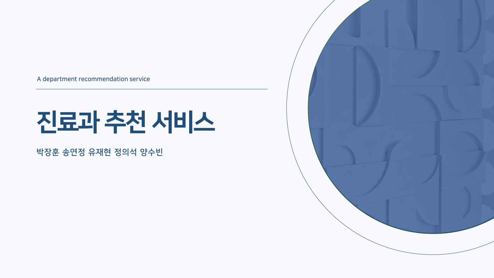
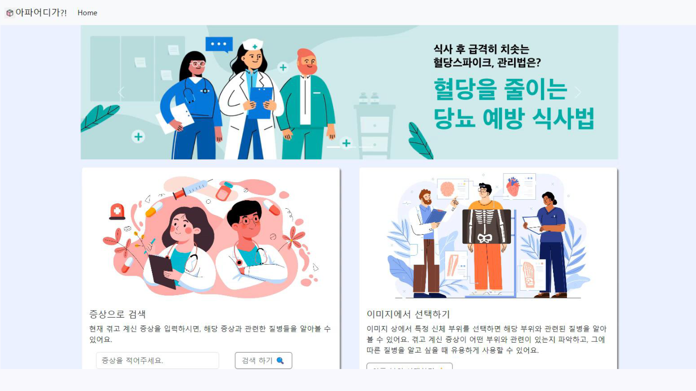
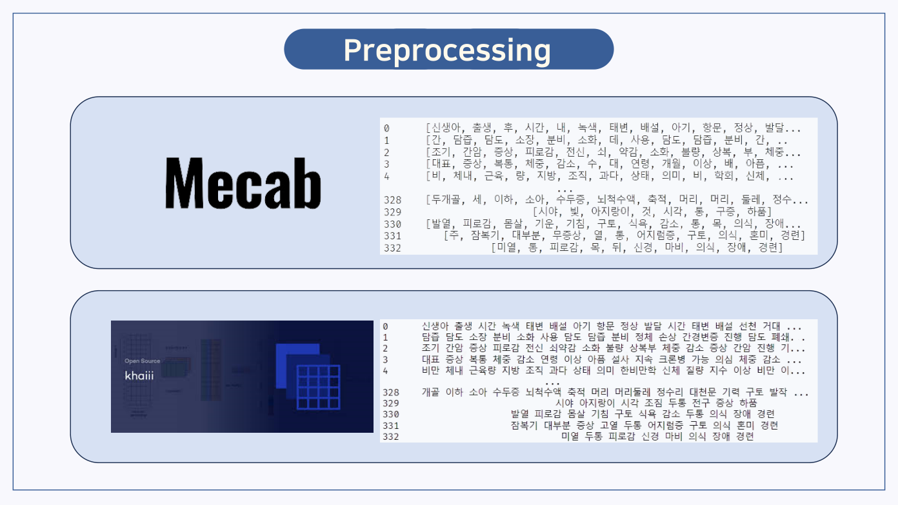
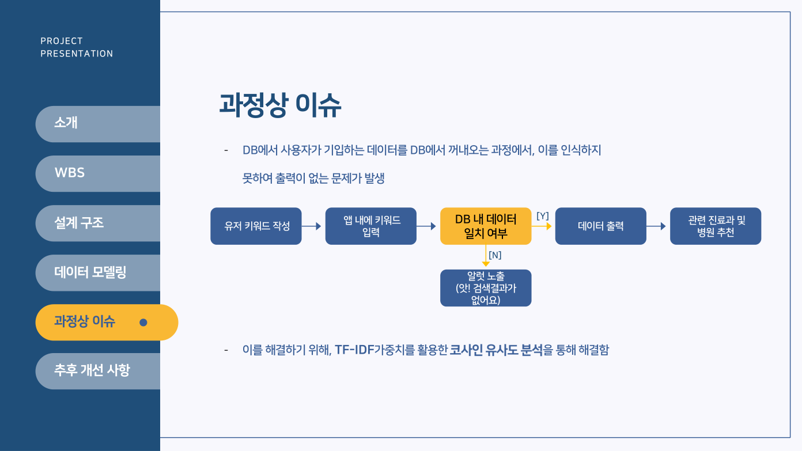

<div align="center">

# 🩺 진료과 추천 서비스

### Department Recommendation Service

**증상 텍스트를 기반으로 관련 질환 및 진료과를 탐색하는 웹 서비스**

`Multicampus` · `Data Analytics & Engineering Bootcamp` · `Final Team Project`



[📄 최종 발표자료 PDF 보기](멀티캠퍼스_최종프로젝트_진료과추천서비스.pdf)

</div>

---

## 📌 프로젝트 소개

어떤 진료과를 방문해야 할지 고민하는 사용자를 위해 **입력한 증상과 관련된 질환·진료과 정보를 추천**하는 서비스를 기획하고 구현한 팀 프로젝트입니다.

- **텍스트 검색:** 사용자가 증상을 입력하면 관련 질환 및 진료과를 안내
- **이미지 기반 검색:** 발표자료에 소개된 서비스 구성 요소 (구현 범위는 발표자료 참고)
- **진행 방식:** 5인 팀 프로젝트
- **프로젝트 성격:** 멀티캠퍼스 데이터&분석 엔지니어 취업캠프 최종 프로젝트

> ⚠️ 이 프로젝트는 교육 목적의 시연 서비스입니다. 의료적 진단이나 전문적인 진료 안내를 대신하지 않습니다.

## 👨‍💻 나의 담당 업무

이 저장소에서는 **유재현이 직접 담당한 업무**와 **팀 전체 개발 내용**을 구분해 기록합니다.

| 담당 영역 | 수행 내용 |
| --- | --- |
| 데이터 수집 | **Selenium**을 활용한 웹 텍스트 데이터 수집 |
| 데이터 전처리 | **MeCab**을 이용한 한국어 텍스트 **형태소 분석** 및 전처리 |

**작업 흐름**

```text
웹 데이터 수집 (Selenium)
       ↓
한국어 텍스트 정리
       ↓
형태소 분석 (MeCab)
       ↓
후속 분석·추천 모델링에 사용할 데이터 준비
```

> 아래 기술 구성과 추천 모델 검토는 **팀 프로젝트 전체의 작업 내용**입니다. 모든 항목을 개인이 직접 구현했다는 뜻은 아닙니다.

## 🛠️ 기술 스택

| 분류 | 팀 프로젝트에서 사용하거나 검토한 기술 |
| --- | --- |
| Language / Web | Python, HTML, CSS, JavaScript, Django |
| Data Collection | Selenium |
| NLP / Preprocessing | MeCab, Khaiii, TF-IDF |
| Similarity / ML | Cosine Similarity, RandomForest, SVC, XGBoost, RNN |
| Database | SQLite |
| Collaboration | Discord, Slack, Notion |

## 🧩 서비스 구조

```text
사용자 증상 입력
       ↓
Django 웹 서비스
       ↓
텍스트·키워드 처리 및 데이터 조회
       ↓
질환·증상 데이터 / 추천 로직
       ↓
관련 진료과 정보 표시
```

### 서비스 화면



*최종 발표자료의 서비스 화면 (13페이지)*

## 🔍 프로젝트 주요 과정

### 1. 데이터 수집 및 전처리

- 발표자료 기준, 병원 질환·증상 데이터와 네이버 지식iN 텍스트 데이터를 활용했습니다.
- 발표자료에는 지식iN 크롤링 데이터 **3,722,534행 / 11.59GB**, 병원 질환 데이터 **334건**이 소개되어 있습니다. 이는 **팀 발표자료에 기재된 데이터 규모**이며 개인 수집 분량을 뜻하지 않습니다.
- 한국어 형태소 분석에는 MeCab과 Khaiii가 소개되어 있으며, **내 담당 도구는 MeCab**입니다.



*최종 발표자료의 전처리 결과 (17페이지)*

### 2. 추천 방식 검토 — 팀 프로젝트

- RandomForest, SVC, XGBoost, RNN 등 여러 모델을 비교했습니다.
- 입력 문구가 데이터베이스에 정확히 일치하지 않으면 검색 결과가 출력되지 않는 문제를 확인했습니다.
- 팀에서는 **TF-IDF와 코사인 유사도**를 활용해 유사한 문구를 찾는 방법을 검토·적용했습니다.



*최종 발표자료의 과정상 이슈 (24페이지)*

## 📝 회고 및 다음 과제

이 프로젝트를 통해 **실제 데이터를 수집하고, 한국어 텍스트를 형태소 단위로 전처리하는 경험**을 쌓았습니다. 데이터의 형태와 품질이 후속 분석에 영향을 준다는 점을 학습했습니다.

발표자료에서 제시한 후속 개선 방향은 다음과 같습니다.

- 사용자 키워드·결과 로그 수집 및 분석(EFK 활용 구상)
- 설문 기반 추천 기능
- 미구현 추천 모델 보완

위 항목은 **향후 개선 계획**으로, 현재 구현 완료 기능으로 표기하지 않았습니다.

## 📎 발표자료

전체 기획 의도, 데이터 흐름, 모델 검토와 테스트 내용은 아래 PDF에서 확인할 수 있습니다.

**➡️ [멀티캠퍼스 최종 프로젝트 발표자료 열기 (PDF, 32페이지)](멀티캠퍼스_최종프로젝트_진료과추천서비스.pdf)**

---

<div align="center">
  <sub>Developed as a team project at Multicampus · README curated by Yoo Jaehyeon</sub>
</div>
